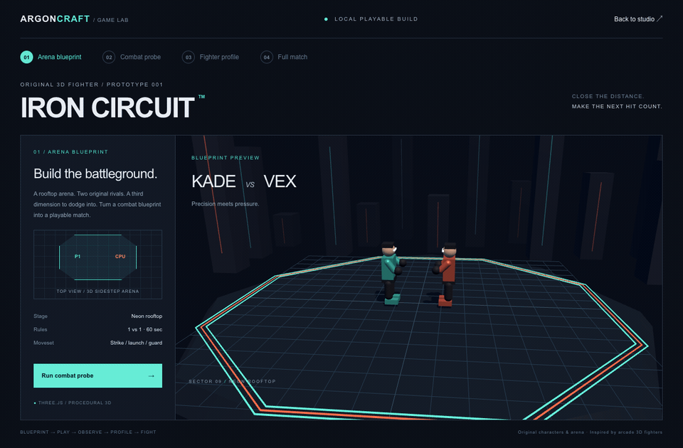

# ArgonCraft 3D

A visual game studio with an original, playable 3D arcade fighter: **Iron Circuit**. Two procedural martial artists face off on a neon rooftop with punches, kicks, launchers, blocking, depth movement, and a CPU opponent. Inspired by Tekken-style arena combat; all characters and geometry are original.



## Play locally

```sh
npm ci
npm run dev
```

Open **http://localhost:3000/?game=iron-circuit**, or select **Play Iron Circuit · 3D Fighter** in the main studio. Requires a browser with WebGL. No API key is needed for this fighting-game flow.

## End-to-end flow

1. **Arena blueprint** — preview the rooftop, fighter spawn positions, and match rules.
2. **Combat probe** — play a 20-second sparring round. Actual attacks, hits, blocks, and sidestep inputs are recorded. Neither fighter can be knocked out during the probe.
3. **Fighter profile** — local rules classify your inputs as pressure, counter, or movement-oriented play, and choose the CPU’s opening attack delay. With no inputs, the profile defaults to balanced.
4. **Full match** — fight a fresh CPU opponent for one 60-second round. Zero health ends the round; otherwise, remaining health decides the winner. Equal health is a draw.
5. **Result & rematch** — review clean hits, damage, and best hit chain; rematch or return to the blueprint.

This is a local procedural prototype, not a Gemini-generated fighting game. The existing canvas → micro-demo → full-game Gemini pipeline remains accessible from **Back to studio**. The GIF records the real local flow with scripted keyboard input; playback is accelerated.

## Controls

| Input | Action |
| --- | --- |
| A / D or ← / → | Move horizontally; approach or retreat |
| W / S or ↑ / ↓ | Sidestep into the arena’s depth |
| J | Jab — 8 damage, short recovery |
| K | Kick — 14 damage, longer reach |
| L | Launcher — 20 damage, airborne hit reaction |
| Space | Guard — reduces incoming strikes to 1 chip damage |

Hold an attack key to repeat after recovery. Attacks must be in range; movement and attacks pause during hit stun. The on-screen buttons support pointer/touch input. “Best chain” counts hits less than 1.4 seconds apart; it is not a guaranteed combo system. The prototype has one arena, two fighters, and one-round matches.

## Verify and reproduce the GIF

```sh
npm run build
node scripts/test-combat.mjs
# With Vite running, install Playwright without changing the project dependencies:
npm install --no-save --package-lock=false playwright
node scripts/capture-fighter.mjs
ffmpeg -y -framerate 12 -i /tmp/iron-circuit-frames/%05d.png \
  -filter_complex "[0:v]scale=960:-1:flags=lanczos,split[a][b];[a]palettegen=stats_mode=diff[p];[b][p]paletteuse=dither=bayer:bayer_scale=3" \
  -loop 0 docs/iron-circuit-flow.gif
```

The capture script uses installed Google Chrome, verifies the probe/profile/match/result/rematch flow, checks mobile overflow and the main-studio entry link, and rejects browser page errors. `BASE_URL` can target a production preview server. `PLAYWRIGHT_MODULE` can point to an existing Playwright module; `CAPTURE_DIR` overrides the frame directory (use an empty directory for a fresh capture).

Combat checks cover hit timing, one hit per attack, guarding, depth-based misses, launch reactions, knockout, timeout, draw, probe survival, arena boundaries, and profile selection.
